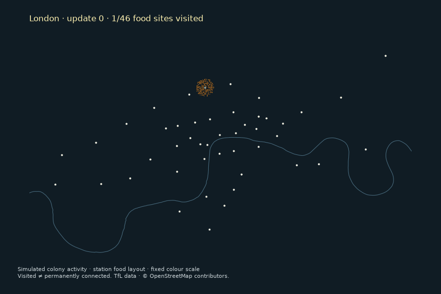
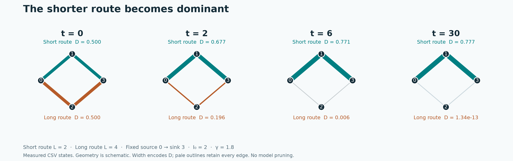
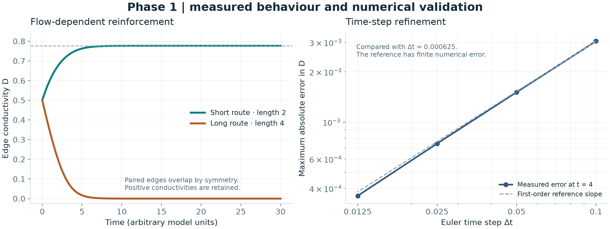
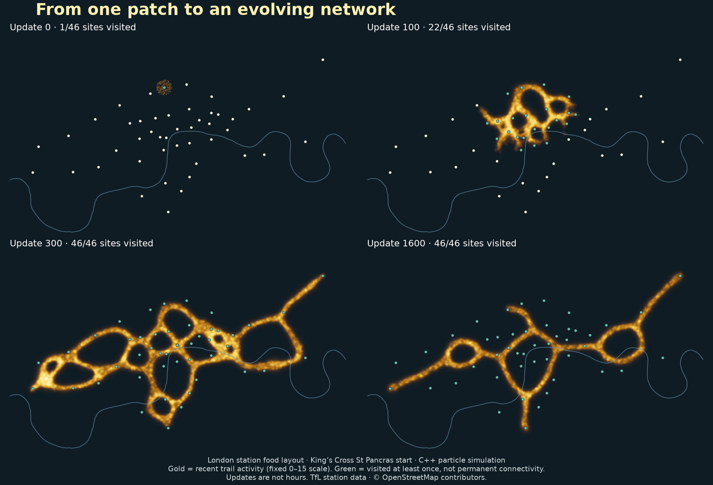
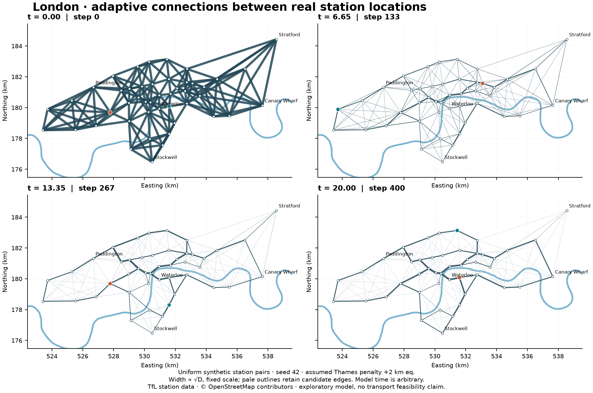

<p align="center">
  
</p>

<p align="center">
  <a href="https://github.com/tiraaamisuuu/physarum-networks/actions/workflows/ci.yml"></a>
  
  
  
</p>

<p align="center">
  <a href="#quick-start">Quick start</a> ·
  <a href="#native-desktop-viewer">Desktop viewer</a> ·
  <a href="#measured-results">Results</a> ·
  <a href="docs/MATHEMATICAL_MODEL.md">Mathematics</a> ·
  <a href="docs/LITERATURE.md">Literature</a> ·
  <a href="docs/RESEARCH_LOG.md">Research log</a>
</p>

# Physarum Networks

**Investigating how local, flow-dependent adaptation shapes transport networks.**

This research project implements the adaptive tube model of [Tero et al. (2010)](https://doi.org/10.1126/science.1177894) in C++20. Pressure differences drive flow; flow reinforces tube conductivity; the updated conductivities redistribute the next flow.

The project includes an independently checked four-node flow baseline and two native London experiments: a **growth laboratory** where a small inoculum spreads toward station food sites, and a **station-connection explorer** using the Tero pressure-flow equations. The growth mode uses a separate, explicitly documented particle model. These are exploratory experiments, not Tube engineering designs or exact replications of the published Tokyo study.

## Watch growth from one starting patch



The default native window starts a small patch at **King’s Cross St Pancras**. The other selected stations act as food sites. Simulated particles sense nearby cues, move, deposit trail and grow locally; winding branches and loops emerge across the surface. A changing explanation panel, visit history and population plot help interpret what is happening.

Gold shows recent trail activity. Green markers mean **visited at least once**, not permanent connectivity. The animation uses actual recorded C++ fields. It does not draw preset railway routes or map its curves to train engineering constraints. [Growth guide, model and assumptions](docs/GROWTH_EXPERIMENT.md) · [Figure provenance](docs/assets/README.md)

## Validated flow adaptation



The source is node **0** and the sink is node **3**. The routes have total lengths **2** and **4**. Every edge begins with the same conductivity. Under this setup, the shorter route gains flow and conductivity while the longer route decays continuously. No edge-deletion rule is used.

*Geometry is schematic. Inner line width represents conductivity; pale outlines retain every original edge. Times are arbitrary model units. See [figure provenance](docs/assets/README.md).*

## Measured results



| Check | Recorded Phase 1 result |
| :--- | ---: |
| Maximum flow-conservation residual | `1.78 × 10⁻¹⁵` |
| Maximum error against independent analytic flows | `1.78 × 10⁻¹⁵` |
| Maximum normalized pressure residual | `1.27 × 10⁻¹⁶` |
| Final short-route conductivity, per edge | `0.776895386795` |
| Final long-route conductivity, per edge | `1.34 × 10⁻¹³` |
| Repeated-run output | Byte-identical |

The baseline uses `I₀ = 2`, `γ = 1.8`, `Δt = 0.05`, initial `D = 0.5`, and duration `30`. Tests compare pressures and flows with hand-calculated circuit solutions and compare the update with an exact scalar Euler recurrence. Halving the time step approximately halves the measured transient error for this fixture. The fine-step comparison has finite numerical error.

**Validation scope:** the current 19 CTest cases pass locally in Release and Debug with UndefinedBehaviorSanitizer on macOS ARM64; 39 Python checks cover the native viewers, growth/geographic preparation and run integrity. The table above records the original Phase 1 experiment. Automated builds run on Ubuntu and macOS; the badge above reports their current status. [Measured report](results/phase1/REPORT.md) · [Full validation data](results/phase1/validation.json) · [Recorded test logs](results/verification)

## Native desktop viewer

The native Qt application opens the **Growth laboratory**, with 46 station food sites and a local King’s Cross inoculum. The File menu also opens the previous **46-station / 183-candidate-connection** experiment and the four-node validation viewer. C++ computes every simulation state; Python provides the interface and scientific plots. Normal use works offline with frozen geographic inputs.

After building the C++ project, install the viewer dependencies and launch. The pinned viewer stack supports Python 3.12–3.14 and is tested with 3.14:

```sh
python3.14 -m venv .venv
.venv/bin/python -m pip install -r desktop/requirements.txt -r analysis/requirements.txt
.venv/bin/python desktop/viewer.py
```

On macOS, double-click **`Launch Physarum.command`** in Finder. It prepares the local environment if needed, builds the engine and opens the native window. Press **Play growth** to watch the colony expand. The explanations update as you move through the recorded states.



The previous connection experiment remains available through **File → Open station-connection experiment**, or `.venv/bin/python desktop/viewer.py --network`:

- Click stations or links to inspect their values and trajectories.
- Choose different stations, add hypothetical junctions or drag restricted rectangles, then **Run adaptation**.
- Try Thames penalties of 0 and 2 with the same seed to explore the effect of an assumed crossing cost.
- Every run saves its scene, cost assumptions, exact demand schedule, C++ output and software hashes locally.

**Real geography does not make the transport assumptions real:** demand is synthetic, links are straight candidate segments, and surface elevation is visual context only. The crossing penalty is an assumed km-equivalent resistance length. Capacity, passenger journey times, service patterns and ground conditions are not modelled. [London guide and protocol](docs/LONDON_EXPERIMENT.md) · [Data provenance and licences](data/london/README.md)



*Fixed width scale proportional to √D; pale outlines retain possible connections. Actual recorded states, arbitrary model time. [Figure provenance](docs/assets/README.md).*

The original four-node viewer is available from **File → Open validated four-node viewer**, or `.venv/bin/python desktop/viewer.py --fixture`. It retains run archives and analytic-fixture inspection. [Viewer documentation](docs/DESKTOP_VIEWER.md).

## Quick start

Requires a C++20 compiler, CMake ≥3.20 and Eigen. The locally verified configuration uses Apple Clang 17, CMake 4.0.2 and Eigen 5.0.1.

```sh
git clone https://github.com/tiraaamisuuu/physarum-networks.git
cd physarum-networks

# macOS dependencies
brew install cmake eigen

cmake -S . -B build -DCMAKE_BUILD_TYPE=Release
cmake --build build --parallel
ctest --test-dir build --output-on-failure

./build/physarum_run experiments/configs/two_routes.cfg results/manual
```

On Ubuntu, install `build-essential`, `cmake` and `libeigen3-dev` with your package manager, then use the same configure, build, test and run commands. See [build and experiment instructions](docs/BUILDING.md) for configuration options and solver diagnostics.

### Reproduce the figures

For growth snapshots and the animation, run `.venv/bin/python analysis/make_growth_figure.py --gif`. For the station-connection London snapshots, run `.venv/bin/python analysis/make_london_figure.py` after installing both desktop and analysis dependencies. It computes the frozen default example, saves the raw run locally and writes PNG/SVG snapshots with a compact provenance JSON.

The C++ program performs the simulation. Python validates the exported CSV data and generates the plots. The recorded analysis environment uses Python 3.14; dependency versions are pinned.

```sh
python3 -m venv .venv
.venv/bin/python -m pip install -r analysis/requirements.txt
.venv/bin/python analysis/run_validation.py
.venv/bin/python analysis/make_readme_figures.py
```

The validation script records configurations, histories, source hashes and software versions. Rerunning overwrites `results/phase1/`; use `--output results/another-run` to preserve the recorded dataset. The README-figure script reads the recorded `results/phase1/` dataset.

## Model

For an edge connecting nodes $i$ and $j$:

$$
Q_{ij}=\frac{D_{ij}}{L_{ij}}(p_i-p_j),
\qquad
\frac{dD_{ij}}{dt}=\frac{|Q_{ij}|^\gamma}{1+|Q_{ij}|^\gamma}-D_{ij}.
$$

At each iteration, the engine solves a grounded graph Laplacian for pressure, computes signed edge flows and updates all conductivities simultaneously with explicit Euler. Conservation and solver residuals are checked before results are accepted.

The core uses a dense, diagonally scaled Eigen LDLT solver. It retains positive conductivities without a floor, handles demand-free disconnected components, and reports an error when terminals disconnect or the pressure system becomes numerically unresolved. The full derivation, tolerances and independent test cases are documented in the [mathematical model](docs/MATHEMATICAL_MODEL.md).

## Research scope

| Milestone | Status |
| :--- | :--- |
| **Phase 1 — mathematical baseline** | Implemented and locally validated |
| **Phase 2 — published network behaviour** | Next: resolve and document the reproduction protocol |
| **Phase 3 — research extensions** | Deferred pending baseline reproduction and literature review |

The fixed terminals, uniform initialization and four-node graph are validation choices. The 2010 paper uses random food-source pairs and a fine mesh. This repository does **not** yet reproduce its Tokyo experiment, establish general shortest-path convergence for the sigmoid law, or demonstrate resilience or real transport-system feasibility. The dense solver is intended for small graphs, and Euler step-size accuracy must be checked for each setup. Local AddressSanitizer verification remains inconclusive because its runtime stalled before `main`; the separate UBSan run passed.

The London explorer is a separately documented geographic extension with synthetic terminal sampling. The growth laboratory adds a distinct Jones-inspired particle model for a local inoculum and food sites. Both support hands-on exploration and document their differences from published experiments. A source-audited reproduction protocol and controlled numerical/statistical studies remain necessary before interpreting it as published network reproduction or transport research evidence. No originality claim is made.

## Explore the project

| Location | Contents |
| :--- | :--- |
| [`include/physarum/`](include/physarum) · [`src/`](src) | Graph, flow solver, adaptation model and CLI |
| [`tests/`](tests) | Analytic fixtures and numerical checks |
| [`experiments/configs/`](experiments/configs) | Reproducible experiment parameters |
| [`analysis/`](analysis) | Independent CSV checks and figure generation |
| [`desktop/`](desktop) | Growth laboratory, geographic explorer, four-node viewer and C++ data bridges |
| [`data/london/`](data/london) | Frozen TfL/OSM/elevation inputs and source attribution |
| [`results/phase1/`](results/phase1) | Recorded histories, diagnostics and figures |
| [`docs/`](docs) | [Project brief](docs/PROJECT_BRIEF.md), [literature notes](docs/LITERATURE.md), [bibliography](docs/references.bib) and research record |

## References and citation

The principal model source is Tero et al., *Rules for Biologically Inspired Adaptive Network Design*, **Science** 327(5964), 439–442 (2010), [doi:10.1126/science.1177894](https://doi.org/10.1126/science.1177894). Related Physarum and fungal-network studies are recorded in the [literature review](docs/LITERATURE.md) and [BibTeX bibliography](docs/references.bib), with differences between their model assumptions noted explicitly.

To cite this software, use GitHub’s **Cite this repository** entry or [`CITATION.cff`](CITATION.cff). Cite the scientific model papers separately when discussing their results.
