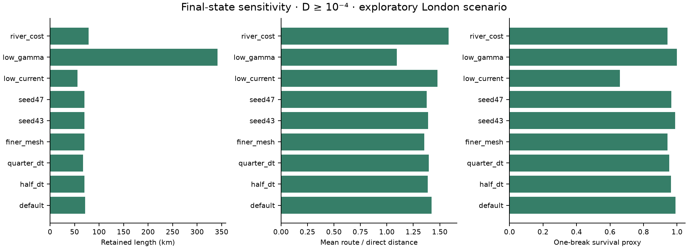

<p align="center"></p>
<p align="center"><a href="https://github.com/tiraaamisuuu/physarum-networks/actions/workflows/ci.yml"></a> · C++20 · Eigen · Native Qt</p>

# Physarum Networks

**Experiment with flow-driven tube adaptation on real London station coordinates.**

The native laboratory implements the pressure–flow and sigmoid conductivity equations from [Tero et al., Science (2010)](https://doi.org/10.1126/science.1177894). A fine candidate mesh adapts into thin, branching routes. Every food source is an exact mesh vertex. The interface measures the resulting network, exposes numerical diagnostics and exports figures with the underlying data.


*Actual C++ output, not an illustration. Width ∝ D¼ on a fixed scale; tubes below D = 10⁻⁴ are omitted from the displayed/measured graph. Raw conductivities remain unchanged. TfL coordinates · © OpenStreetMap contributors.*

## Run it

On the development Mac, open **`Desktop/physarum/Launch Physarum.command`**. It builds the engine and opens the **Tube-network laboratory**. Then:

1. Press **Play adaptation** to watch the fine mesh thin into routes, or **Final state** to inspect the result.
2. Click a tube for its conductivity, signed flow and full trajectory. The **Food sources** tab lists the exact vertices and incident tubes.
3. Use **Layout** to choose stations on the map or draw geographic exclusions. Change parameters, then **Compute tube experiment**. **Compare runs** compares final states at the same cutoff.
4. Use **Parameter study** to vary one parameter across matched random seeds, inspect individual outcomes and save an incremental CSV summary.
5. Use **Export figure + data** for SVG, PNG, per-tube/per-node CSV and a JSON summary. Complete runs save automatically under `results/mesh_runs/`.

Optional CSV imports define documented relative food-pair frequencies. The surface-elevation overlay is attributed context; it does not stand in for underground geology.

The **Equations & record** tab explains the model and suggests controlled experiments. **File** saves/opens experiment designs and recorded runs. Normal use works offline with the frozen geographic data.

**This model begins with a pre-existing mesh, as in the paper’s numerical experiment. It does not simulate the biological expanding colony margin shown in its photographs.** The previous particle foraging experiment remains available through **Other models** or `--particles`; its glowing trail field is not tube conductivity. The four-node analytic fixture remains available through `--fixture`.

## What happens


For each tube, pressure differences drive flow:

$$Q_{ij}=\frac{D_{ij}}{L_{ij}}(p_i-p_j),\qquad
\frac{dD_{ij}}{dt}=\frac{|Q_{ij}|^\gamma}{1+|Q_{ij}|^\gamma}-D_{ij}.$$

At every vertex, net outflow equals the imposed food-to-food current. All conductivities update simultaneously with explicit Euler. Demand switches among recorded food pairs at a fixed model-time interval, independent of integration step size. The mesh solver uses scaled sparse LDLT and iterative refinement; it applies no conductivity floor or edge pruning.

The map follows the actual mesh geometry, including intermediate junctions. It does not use cosmetic curve smoothing. Tube width follows the fourth-root conductivity relationship associated with Poiseuille radius scaling at fixed viscosity; it is a display scale, not a calibrated biological radius.

## Measured London example

Default: 46 food sites, seed 42, mesh spacing 0.45 km, I₀ = 2, γ = 1.8, Δt = 0.05, duration 30. All measurements below use D ≥ 10⁻⁴.

| Measurement | Recorded result |
| :--- | ---: |
| Food sources in one connected component | 46 / 46 |
| Retained physical tube length | 71.85 km |
| Mean route / direct distance, across all food pairs | 1.421 |
| Maximum flow-conservation residual, all states | 2.73 × 10⁻¹³ |
| Maximum normalized pressure residual, all states | 2.17 × 10⁻¹⁶ |

These are measurements of this exploratory network, not evidence of an optimal railway. Station coordinates are real; demand is synthetic. River crossing penalties are explicit assumed resistance costs. Ground conditions, tunnelling, capacity, service patterns, curvature limits and passenger journey times are not modelled.



The nine-case study includes time-step refinement, a finer mesh, three seeds and parameter contrasts. Lower current retained a shorter network with fewer alternatives. Lower γ retained a much denser mesh. **Time-step refinement changes final geometry**: maximum transient conductivity differences decrease from 0.1903 to 0.08759 as Δt is halved twice, but that is not a general convergence proof. The experiment needs seed, mesh, integration and cutoff studies before stronger conclusions.

[Study report](results/mesh_validation/REPORT.md) · [Measured JSON](results/mesh_validation/validation.json) · [Frozen replay inputs and reference snapshots](results/mesh_validation/replay/) · [Model and interpretation guide](docs/TUBE_EXPERIMENT.md)

## Build from source

Requires C++20, CMake ≥3.20, Eigen and Python 3.12–3.14. The pinned viewer dependencies are tested with Python 3.14.

```sh
git clone https://github.com/tiraaamisuuu/physarum-networks.git
cd physarum-networks
# macOS; Ubuntu: build-essential cmake libeigen3-dev
brew install cmake eigen
cmake -S . -B build -DCMAKE_BUILD_TYPE=Release
cmake --build build --parallel
ctest --test-dir build --output-on-failure
python3.14 -m venv .venv
.venv/bin/python -m pip install -r desktop/requirements.txt -r analysis/requirements.txt
.venv/bin/python desktop/viewer.py
```

Other modes: `--fixture` for the analytic circuit, `--network` for the older coarse station graph, `--particles` for the separate particle experiment. `--mesh-run PATH` reopens a tube run. [Build details](docs/BUILDING.md).

```sh
# Recompute the nine-case study and figures; overwrites its recorded report inputs.
.venv/bin/python analysis/run_mesh_validation.py
# Replay the archived exact graph, initial values and demand schedule independently.
.venv/bin/python analysis/replay_mesh_case.py results/mesh_validation/replay/default
# Native data/UI checks (headless).
QT_QPA_PLATFORM=offscreen .venv/bin/python -m unittest discover -s tests -p 'test_*.py' -v
```

## Validation and research scope

The original four-node baseline compares against analytic pressures, flows and an exact scalar adaptation solution. New sparse tests compare with that dense solver across terminals and switched-demand histories; NumPy independently solves a recorded mesh state. Record validation checks conservation, the pressure law, dissipation/work identity, every Euler transition, exact food attachment and file checksums. Metric fixtures test trees, cycles and disconnections.

Locally, **27 CTests** pass in Release and Debug with UndefinedBehaviorSanitizer; **61 Python tests** pass. Tests check implementation and numerical contracts, not biological fidelity. Hosted Ubuntu/macOS outcomes are reported by the build badge. [Mathematical contract](docs/MATHEMATICAL_MODEL.md) · [Original baseline report](results/phase1/REPORT.md).

The paper’s numerical equations are implemented, but mesh construction, initial fluctuations, demand timing and integration are documented choices. This is not an exact Tokyo replication, calibrated biological simulator, validated Tube design or a claim of new science. The previous particle model’s local-activity metrics did not establish maintained food connectivity; it is no longer the default research view. [Research log](docs/RESEARCH_LOG.md).

## Project map

| Location | Contents |
| :--- | :--- |
| [`src/`](src) · [`include/physarum/`](include/physarum) | Dense/sparse pressure solvers, tube adaptation, particle model, CLIs |
| [`desktop/`](desktop) | Native laboratory, quantitative plots, record validation and exports |
| [`tests/`](tests) | Independent mathematical, topology, integrity and UI checks |
| [`analysis/`](analysis) | Repeatable studies and scientific figure generation |
| [`data/london/`](data/london) | Frozen geographic inputs, attribution and licences |
| [`results/mesh_validation/`](results/mesh_validation) | Measured study, frozen inputs and numerical snapshots |
| [`docs/`](docs) | [Project brief](docs/PROJECT_BRIEF.md), [literature](docs/LITERATURE.md), [bibliography](docs/references.bib), research history |

Principal source: Tero et al., *Rules for Biologically Inspired Adaptive Network Design*, **Science** 327, 439–442 (2010), [doi:10.1126/science.1177894](https://doi.org/10.1126/science.1177894).

Code: [MIT licence](LICENSE). Geographic data retain their [upstream terms](data/london/README.md). Source PDFs are not redistributed.
