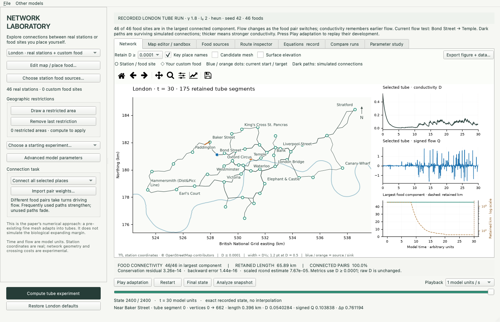
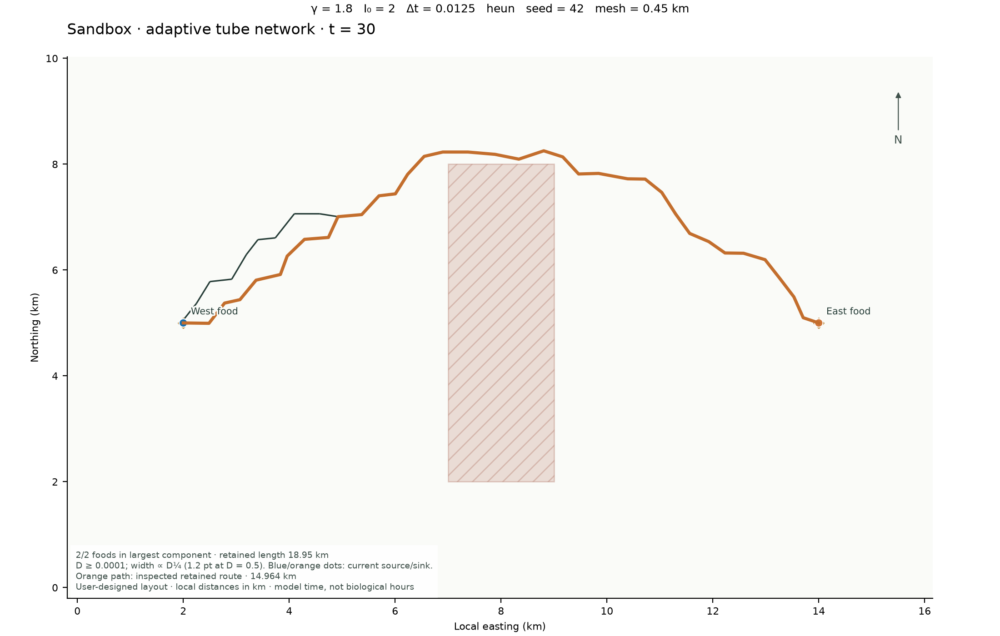
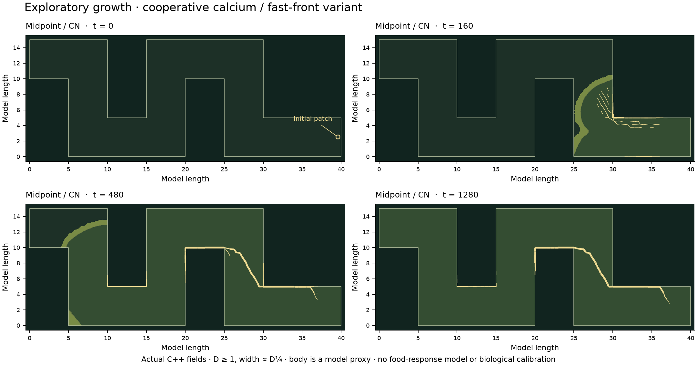
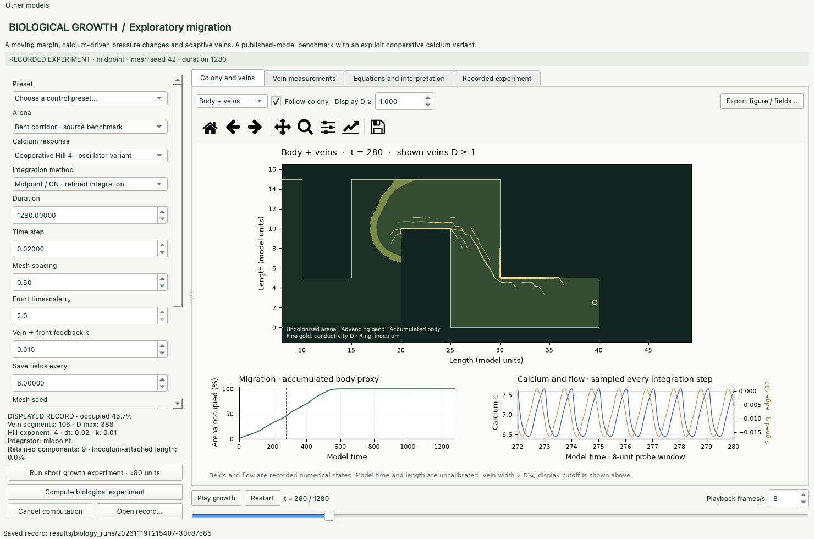
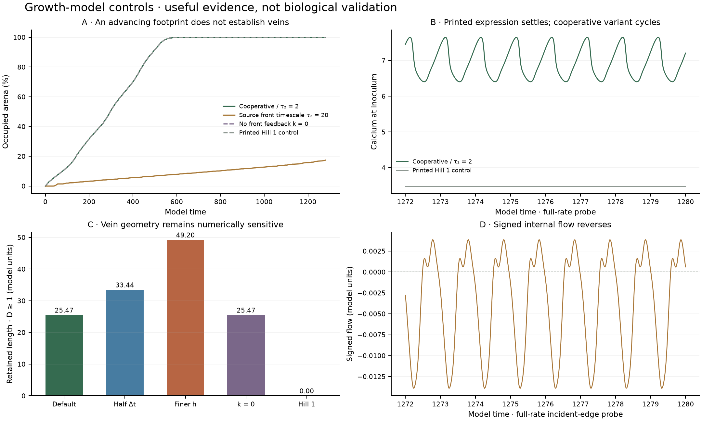
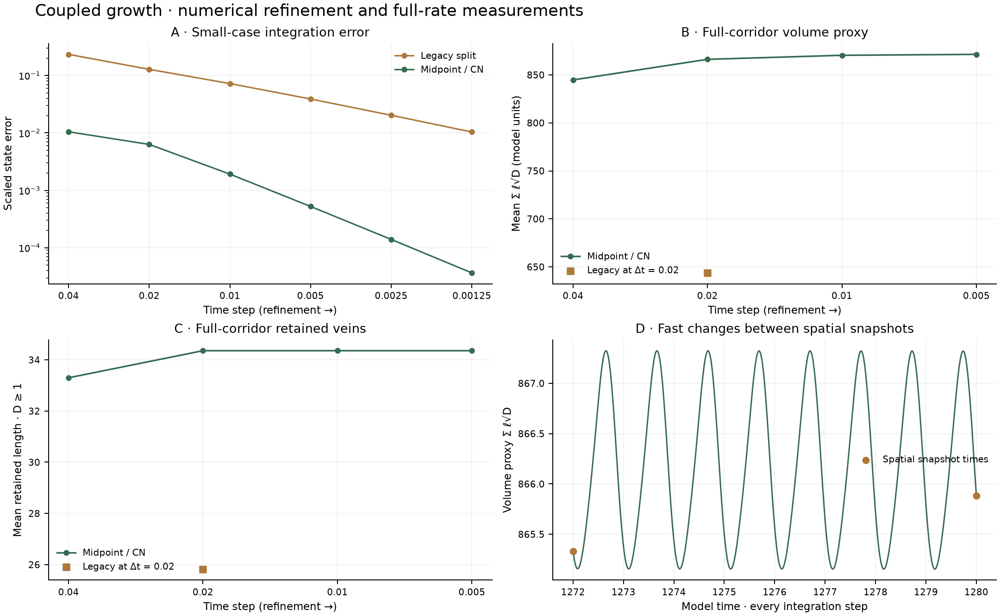
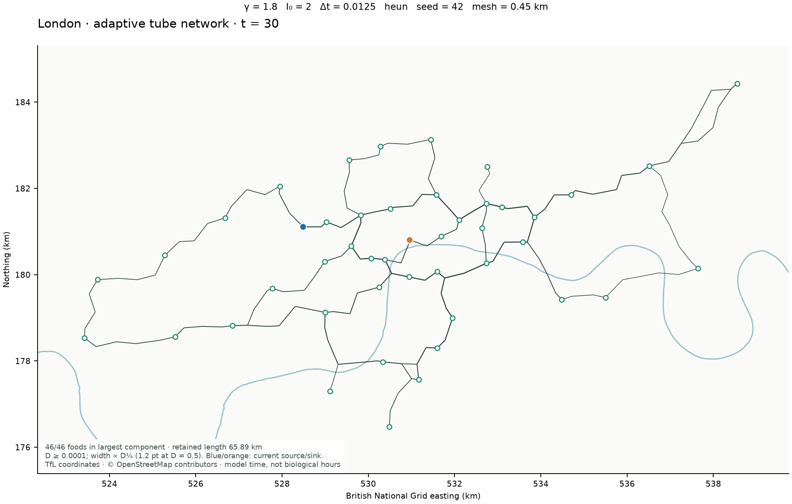
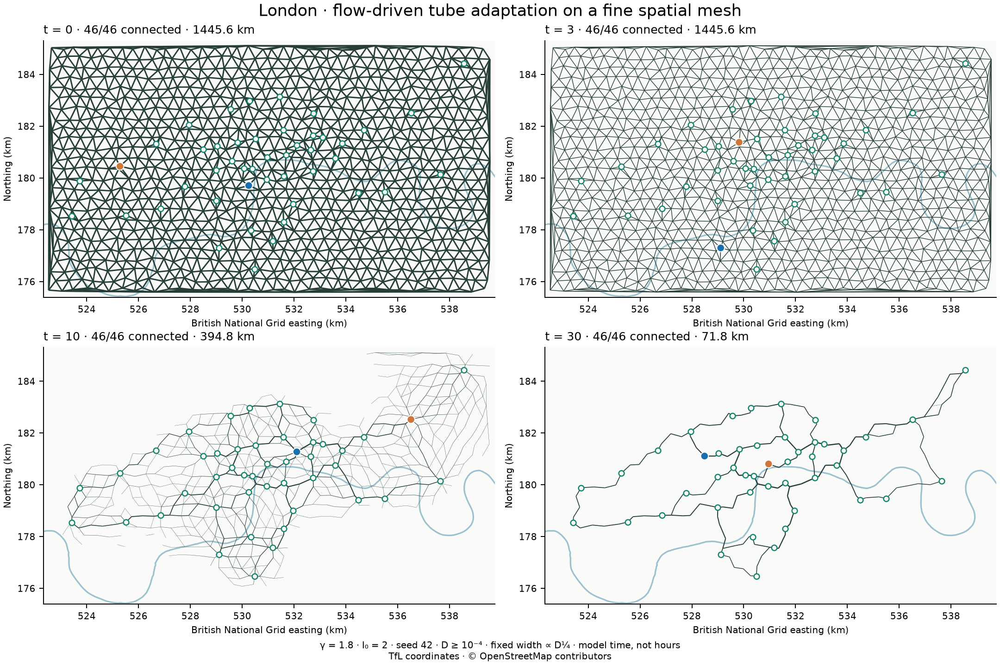
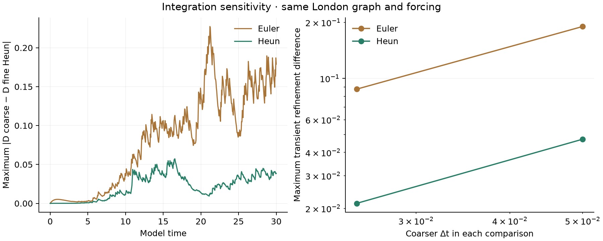

<p align="center"></p>
<p align="center"><a href="https://github.com/tiraaamisuuu/physarum-networks/actions/workflows/ci.yml"></a> · C++20 · Eigen · Native Qt</p>

# Physarum Networks

**Explore London, design your own food-site experiment, and inspect the actual simulated connections.**

The native Qt laboratory opens on a named London station map. Place custom food sources, draw obstacles and test connections with the pressure–flow and tube-adaptation equations of [Tero et al. (2010)](https://doi.org/10.1126/science.1177894). A separate biological-growth benchmark couples an advancing margin, calcium oscillations, pressure, internal flow and adaptive veins, following [Schenz et al. (2017)](https://doi.org/10.1088/1361-6463/aa88e9) with an explicitly identified cooperative calcium variant.



*Actual offscreen Qt widget render of a computed C++ run. Station locations are real; the dark connections are simulated routes, not existing TfL lines.*

## Run it

On the development Mac, open **`Desktop/physarum/Launch Physarum.command`**. It builds the C++ engines and opens **London** at the final computed network. A complete matching local record is reused; otherwise one is computed and saved.

1. Hover a station for its full name. Zoom for more labels. Click a tube to inspect its conductivity and flow; press **Play adaptation** to replay the run.
2. Open **Edit map / place food**. Search for a station, click a grey station to add it, or choose **Place food · click map** for your own points. Rename or edit custom coordinates in the table. Use **Move custom food · drag**, **Remove food · click**, **Undo** and **Redo**.
3. Choose **Blank sandbox** in the sidebar for a fresh local arena. **Load obstacle example** provides two named foods and a blocked rectangle. You can also place custom food directly on London.
4. Choose **Connect all selected places**, or **Find a start → target route** for a fixed pair. Press **Compute tube experiment**. The final network opens automatically; designs and old computed records remain distinct.
5. In **Route inspector**, choose two recorded sites and **Highlight route**. Orange traces the shortest physical-distance route through surviving simulated segments. Disconnected sites remain disconnected. **Export figure + data** includes the route and its underlying measurements.

[Step-by-step sandbox guide](docs/SANDBOX.md) · [Model and numerical protocol](docs/TUBE_EXPERIMENT.md)



*Both food coordinates are exact graph vertices. The obstacle excludes intersecting tubes before the run; the highlighted route uses only retained numerical edges. This is adaptation of an existing candidate mesh, not biological growth or a globally optimal path guarantee.*

## Separate biological growth benchmark

Open **Other models → Biological growth benchmark · corridor**, or use `--biology`. The corridor is a controlled biological modelling experiment, separate from the London and sandbox food-site tool. It does not yet grow towards arbitrary foods on London.



*Actual C++ fields. Fine gold strokes are conductivity, with a fixed fourth-root width scale; body colour is a model proxy. These are not microscopy images. Time and length are uncalibrated.*

The growth model is a **research prototype**, not a quantitative paper reproduction or a validated digital organism. The printed calcium expression settles under the listed coefficients, so the default makes its cooperative exponent and faster front timescale explicit. Food uptake, finite biomass and body retraction are not yet implemented. [Equations, source audit and limitations](docs/BIOLOGICAL_GROWTH.md).

1. Press **Play growth**. Use **Run short growth experiment** to try new settings with the same physics over a shorter duration. **Follow colony** keeps the advancing footprint in view; turn it off to see the full arena.
2. Switch between **Body + veins**, **Advancing margin** and **Calcium**. The adjustable D cutoff changes the drawing, never the underlying simulation.
3. Choose a control preset, then **Compute biological experiment**. Compare the source front timescale, printed calcium response or disabled vein-to-front feedback. Change dt and mesh spacing to test numerical sensitivity.
4. Inspect **Vein measurements**, **Equations and interpretation** and **Recorded experiment**. The lower plots show accumulated occupied area and the separately sampled fast calcium/flow probe.
5. **Export figure / fields** saves PNG, SVG, node/edge CSV and a JSON reference. Complete numerical records save under `results/biology_runs/` with checksums and source snapshots.



*Offscreen widget render at model time 280 from the verified midpoint run; not an interface mockup.*

The current default uses midpoint coupling and Crank–Nicolson diffusion with damped startup. On the frozen corridor mesh, halving Δt from 0.02 to 0.01 leaves the final retained graph unchanged at D ≥ 1; the final-80-unit mean volume proxy changes by 0.485%. The smaller 0.005 reference and the previous method are preserved in the [matched integration study](results/biology_integration/REPORT.md). This is numerical evidence for this setup; the surviving veins still do **not** quantitatively reproduce the biological experiment.

The earlier first-order six-case study remains available. In it, halving dt changed retained length from 25.47 to 33.44, and a finer mesh gave 49.20. Those results are retained as evidence of the limitations of that protocol, rather than relabelled as current default results.



[Earlier six-case growth study and replay instructions](results/biology_validation/REPORT.md).



## London tube-adaptation experiment

London opens by default; `--tubes` remains an alias. Every food source is an exact mesh vertex, and measured connectivity concerns the actual surviving tubes.



*Width ∝ D¼ on a fixed scale; tubes below D = 10⁻⁴ are omitted from the displayed/measured graph. Raw conductivities remain unchanged. TfL coordinates · © OpenStreetMap contributors.*

Press **Play adaptation**, click tubes for D/Q trajectories and inspect the **Food sources** table. **Map editor / sandbox** edits station/custom food sites and exclusions. **Parameter study** runs matched-seed comparisons; **Export figure + data** preserves figures and underlying data. Surface elevation is attributed context, not underground geology. Optional CSV weights specify relative food-pair frequencies, not calibrated passenger demand.

The earlier particle foraging model remains available through **Other models** or `--particles`; its trail field is not vein conductivity. The four-node analytic fixture remains available through `--fixture`.

## Tube-adaptation equations



For each tube, pressure differences drive flow:

$$Q_{ij}=\frac{D_{ij}}{L_{ij}}(p_i-p_j),\qquad
\frac{dD_{ij}}{dt}=\frac{|Q_{ij}|^\gamma}{1+|Q_{ij}|^\gamma}-D_{ij}.$$

At every vertex, net outflow equals the imposed food-to-food current. All conductivities update simultaneously with Euler or two-stage Heun. The default uses Heun at Δt = 0.0125; every predictor pressure/flow and solver diagnostic is recorded and independently checked. Demand switches among recorded food pairs at a fixed model-time interval, independent of integration step size. The mesh solver uses scaled sparse LDLT and iterative refinement; it applies no conductivity floor or edge pruning.

The map follows the actual mesh geometry, including intermediate junctions. It does not use cosmetic curve smoothing. Tube width follows the fourth-root conductivity relationship associated with Poiseuille radius scaling at fixed viscosity; it is a display scale, not a calibrated biological radius.

## Measured London example

Default: 46 food sites, seed 42, mesh spacing 0.45 km, I₀ = 2, γ = 1.8, Heun Δt = 0.0125, duration 30. All measurements below use D ≥ 10⁻⁴.

| Measurement | Recorded result |
| :--- | ---: |
| Food sources in one connected component | 46 / 46 |
| Retained physical tube length | 65.89 km |
| Mean route / direct distance, across all food pairs | 1.401 |
| Maximum flow-conservation residual, all states | 3.66 × 10⁻¹³ |
| Maximum normalized pressure residual, all states | 3.08 × 10⁻¹⁶ |

At Heun Δt = 0.00625, the final retained edge set is identical at this cutoff. Maximum transient D difference is 0.00885; final maximum difference is 0.00132. This finite check applies to this setup, not every parameter or cutoff. [Integration evidence and source-complete replay inputs](results/integration_validation/REPORT.md).



These are measurements of this exploratory network, not evidence of an optimal railway. Station coordinates are real; demand is synthetic. River crossing penalties are explicit assumed resistance costs. Ground conditions, tunnelling, capacity, service patterns, curvature limits and passenger journey times are not modelled.


The archived **Euler baseline** nine-case study includes time-step refinement, a finer mesh, three seeds and parameter contrasts. Lower current retained a shorter network with fewer alternatives. Lower γ retained a much denser mesh. **Time-step refinement changes final geometry**: maximum transient conductivity differences decrease from 0.1903 to 0.08759 as Δt is halved twice, but that is not a general convergence proof. The experiment needs seed, mesh, integration and cutoff studies before stronger conclusions.

[Earlier Euler study](results/mesh_validation/REPORT.md) · [Measured JSON](results/mesh_validation/validation.json) · [Frozen replay inputs and reference snapshots](results/mesh_validation/replay/) · [Model and interpretation guide](docs/TUBE_EXPERIMENT.md)

## Build from source

Requires C++20, CMake ≥3.20, Eigen and Python 3.12–3.14. The pinned viewer dependencies are tested with Python 3.14.

```sh
git clone https://github.com/tiraaamisuuu/physarum-networks.git
cd physarum-networks
# macOS; Ubuntu: build-essential cmake libeigen3-dev
brew install cmake eigen
cmake -S . -B build -DCMAKE_BUILD_TYPE=Release
cmake --build build --parallel
ctest --test-dir build --output-on-failure
python3.14 -m venv .venv
.venv/bin/python -m pip install -r desktop/requirements.txt -r analysis/requirements.txt
.venv/bin/python desktop/viewer.py
```

Other modes: `--sandbox` for an empty food-site arena, `--biology` for the separate biological benchmark, `--biology-run PATH` to reopen a growth run, `--fixture` for the analytic circuit, `--network` for the older coarse station graph, `--particles` for the separate particle experiment. `--mesh-run PATH` reopens a London or sandbox tube run. [Build details](docs/BUILDING.md).

```sh
# Recompute matched biological integration evidence.
.venv/bin/python analysis/validate_biology_integrators.py
.venv/bin/python analysis/plot_biology_integrators.py
# Recompute the earlier biological controls and their figures.
.venv/bin/python analysis/validate_biology.py
.venv/bin/python analysis/plot_biology.py
# Replay preserved growth source and compare the frozen reference.
.venv/bin/python analysis/replay_biology_case.py results/biology_validation/replay/default --build-source
# Recompute tube integration evidence and figures.
.venv/bin/python analysis/compare_integrators.py
# Recompute the earlier nine-case Euler baseline separately.
.venv/bin/python analysis/run_mesh_validation.py
# Replay the archived exact graph, initial values and demand schedule independently.
.venv/bin/python analysis/replay_mesh_case.py results/mesh_validation/replay/default
# Native data/UI checks (headless).
QT_QPA_PLATFORM=offscreen .venv/bin/python -m unittest discover -s tests -p 'test_*.py' -v
```

## Validation and research scope

The original four-node baseline compares against analytic pressures, flows and an exact scalar adaptation solution. New sparse tests compare with that dense solver across terminals and switched-demand histories; NumPy independently solves a recorded mesh state. Record validation checks conservation, the pressure law, dissipation/work identity, every integration transition, exact food attachment and file checksums. Source snapshots and a compiled C++ fingerprint bind new records to their engine source. Metric fixtures test trees, cycles and disconnections.

Locally, **34 CTests** pass in Release and Debug with UndefinedBehaviorSanitizer; **96 Python tests** pass. The sandbox checks include actual C++ obstacle avoidance, exact food attachment, disconnected routes, signed route exports and native editing without record mutation. Tests check implementation and numerical contracts, not biological fidelity. Hosted Ubuntu/macOS outcomes are reported by the build badge. [Mathematical contract](docs/MATHEMATICAL_MODEL.md) · [Original baseline report](results/phase1/REPORT.md).

The tube experiment implements its stated numerical equations; mesh construction, initial fluctuations, demand timing and integration are documented choices. The growth experiment has additional source-equation ambiguities and explicitly labelled variants. This is not an exact Tokyo replication, calibrated biological simulator, validated Tube design or a claim of new science. The previous particle model’s local-activity metrics did not establish maintained food connectivity; it is no longer the default research view. [Research log](docs/RESEARCH_LOG.md).

## Project map

| Location | Contents |
| :--- | :--- |
| [`src/`](src) · [`include/physarum/`](include/physarum) | Dense/sparse pressure solvers, coupled growth/flow, tube adaptation, particle model, CLIs |
| [`desktop/`](desktop) | Native laboratory, quantitative plots, record validation and exports |
| [`tests/`](tests) | Independent mathematical, topology, integrity and UI checks |
| [`analysis/`](analysis) | Repeatable studies and scientific figure generation |
| [`data/london/`](data/london) | Frozen geographic inputs, attribution and licences |
| [`results/biology_integration/`](results/biology_integration) | Matched midpoint/legacy integration evidence and full-rate scalar records |
| [`results/biology_validation/`](results/biology_validation) | Growth controls, source-complete replays and reference fields |
| [`results/integration_validation/`](results/integration_validation) | Current Heun/default evidence, source snapshots and replay inputs |
| [`results/mesh_validation/`](results/mesh_validation) | Earlier Euler sensitivity study and frozen replay inputs |
| [`docs/`](docs) | [Project brief](docs/PROJECT_BRIEF.md), [literature](docs/LITERATURE.md), [bibliography](docs/references.bib), research history |

Principal source: Tero et al., *Rules for Biologically Inspired Adaptive Network Design*, **Science** 327, 439–442 (2010), [doi:10.1126/science.1177894](https://doi.org/10.1126/science.1177894).

Geographic data retain their [upstream terms](data/london/README.md). Source PDFs are not redistributed.
