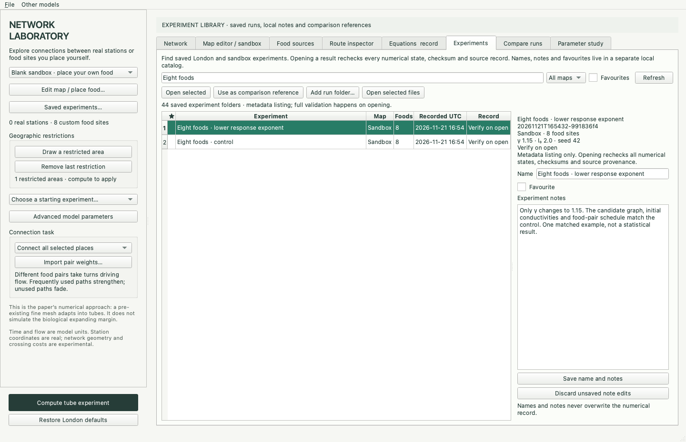
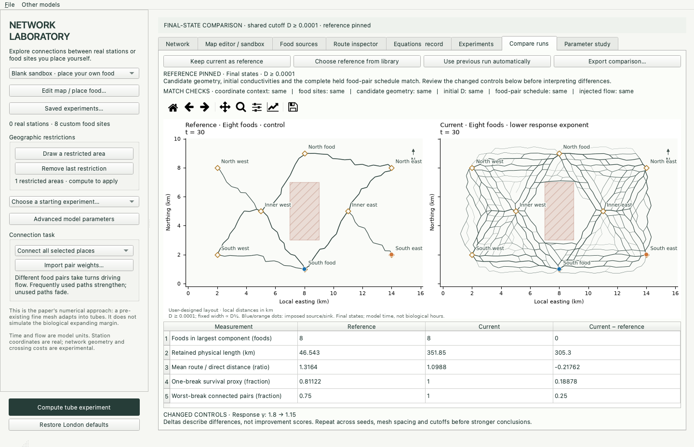

# Find, annotate and compare experiments

Open **Saved experiments…** in the sidebar, **Experiments** in the main tabs, or **File → Experiment library**. The library finds local London/sandbox runs and runs inside parameter studies. **Add run folder…** opens a complete record elsewhere and remembers its location.

Search covers experiment names, notes, food-site names and run IDs. Filter by London/Sandbox or favourites. The recorded date column uses UTC. **Incomplete** means required files are absent; **Unreadable** means metadata could not be read. Neither is silently treated as a valid result.

**Verify on open** is a metadata-listing status, not a scientific validation badge. **Open selected** checks the full saved numerical history, integration transitions, checksums and available source provenance before replacing the current view. A failed check leaves the current result and draft available. Opening a successful record shows its final network; Play replays its saved history.

## Names and notes

Select a row, enter a name and notes, optionally mark it as a favourite, and press **Save name and notes**. Pending edits also save when switching selection or closing. If saving fails, the text stays available; **Discard unsaved note edits** restores the saved annotation.

Names have a 120-character limit; notes have an 8,000-character limit. They are user annotations, separate from model evidence. They never rewrite `scenario.json`, checksums, fields, inputs or source snapshots. Clearing a custom name restores the recorded scene name.

The local catalog is `results/experiment_catalog.sqlite3`, excluded from Git. Annotations identify the exact scenario by SHA-256, so copying the same complete record within this catalog retains its name. A different scenario does not inherit the old record's notes. Move the catalog with the project to retain local annotations; copied records alone do not carry that database. Snapshot exports include `experiment-notes.json` when annotations exist. Comparison exports include separately labelled user annotations.

## Keep a reference while experimenting

1. Open your control run, then choose **Compare runs → Keep current as reference**. Alternatively, select a library result and **Use as comparison reference**.
2. Change one control in the map laboratory and compute, or open another saved result. A pinned reference stays fixed while new current runs arrive.
3. Open **Compare runs**. Both maps show final recorded states at the same conductivity cutoff. Shared coordinate contexts use linked axes: zooming/panning one updates the other. Different coordinate contexts use independent extents and are identified explicitly.
4. Read the match checks and changed controls before interpreting the measurements. The checks distinguish food sites, candidate geometry, initial conductivities, food-pair schedule and injected current. Matching pair schedules alone does not imply matching current magnitude.
5. **Use previous run automatically** restores the previous distinct result as the reference. Reopening the same exact record does not replace that history. Pinning lasts for the current window; names, notes and favourites persist between launches.

*Illustrated local example: the eight-food control at γ = 1.8 versus γ = 1.15, holding other controls fixed. Both connect eight foods at D ≥ 10⁻⁴. The lower exponent retains 351.85 km versus 46.54 km, with mean route/direct ratios 1.099 and 1.316 respectively. These results show a trade-off for one mesh and seed, not an optimum or statistical validation.*

The table reports **current minus reference**, without ranking a positive or negative difference as better. When food populations or coordinate contexts differ, numeric deltas are withheld; each run's own measurements remain visible. An unavailable route statistic stays unavailable when food connectivity is lost.

Matched integration-trajectory differences appear only when the existing strict graph, initialization, model and complete forcing checks pass on nested time grids. These differences are not errors against an exact solution. A single parameter contrast still needs seed, mesh, time-step and extraction-cutoff studies before broader conclusions. Change **Retain D ≥** on Network to update the shared comparison cutoff.

## Export a comparison

**Export comparison…** saves PNG/SVG, `measurements.csv`, `comparison.json`, both original scenario files and available code-source archives. Exports identify reference/current scenario checksums, settings, match conditions, changed controls and the extraction cutoff. Pair-specific directory names avoid mixing exports from different reference/current pairs.

This is a figure/data extract; the full dynamic records remain in their original folders. User notes are labelled separately. Source archives contain indexed code, not the raw trajectory. Reopening a complete run performs full validation again.

## Responsive loading and startup

Metadata arrives progressively. You can open a result before the scan finishes or choose **Stop scanning**. A file that stops responding ends the scan with a clear partial-list message; Refresh retries it. Disk checks run in child processes so cancellation can stop a slow lookup without installing a partial result. The app validates a requested result before adopting it; it never promotes metadata alone into a computed experiment.

On macOS, the launcher prepares the pinned Python runtime under `~/Library/Caches/Physarum/`, reuses it while its requirements and Qt plugin checks match, and repairs missing packages/plugins when needed. It keeps app dependencies separate from the project folder and skips package installation on healthy subsequent launches. The manual source-build `.venv` workflow remains available. The C++ engines still use the project's `build` path. [Build guide](BUILDING.md) · [Sandbox guide](SANDBOX.md).
