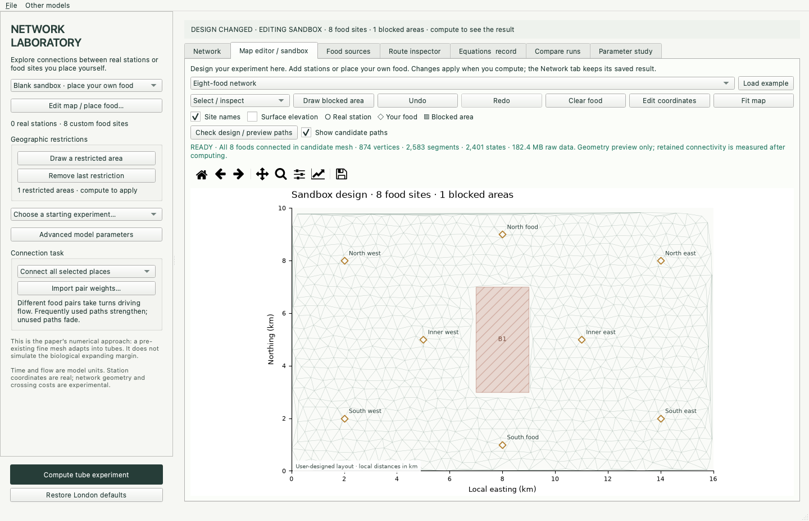

# London and food-site sandbox

Open `Launch Physarum.command` on macOS. The opening London view shows a computed final network. To start directly with a blank arena:

```sh
.venv/bin/python desktop/viewer.py --sandbox
```

## Read the map

Green circles are selected real stations at their TfL coordinates. Amber diamonds are food sites you placed. Blue and orange filled markers show the current imposed start and target. Dark strokes are retained simulated tube segments; thicker strokes mean stronger conductivity. They are experimental connections, not existing Tube lines.

Key station names appear automatically. Hover any food marker for its full name; zoom in to reveal more labels. The map uses geographic coordinates in kilometres, with the Thames as context. It is not the schematic Tube map. **Surface elevation** is an optional London context layer, not tunnelling geology.

The opening view is the final recorded state. **Play adaptation** replays the actual saved states from the initial candidate mesh. **Candidate mesh** shows all possible paths. **Retain D ≥** changes which segments count as visible/measured connections, without changing the simulation.

## Make your own experiment

1. Choose **London · real stations + custom food** or **Blank sandbox · place your own food** in the sidebar. Switching workspace creates a fresh design; **Undo** can restore the previous one.
2. Open **Edit map / place food**. In London, type part of a station name and select a suggestion, then **Use station**. You can also click an unused grey station in **Select / inspect** mode.
3. Choose **Place food · click map** and click empty space. New food sites are exact simulation vertices, not decoration. Selecting/adding food opens its table; **Edit coordinates** also opens or hides the tables. Double-click a custom name or coordinate to edit it.
4. Choose **Move custom food · drag** or **Remove food · click** to adjust the design. Real station names and coordinates stay fixed; remove a station and place custom food if you want to study a different position. **Undo / Redo** restore geometry and stable food IDs.
5. **Draw blocked area** lets you drag a rectangle. Candidate segments intersecting it are excluded before the simulation. Food inside a block is rejected. Click a block in **Select / inspect** mode to select it. In **Blocked areas**, edit its four bounds or remove the selected block. Undo/redo includes these changes.
6. Choose the **Connection task**, then **Check design / preview paths**. The preview uses the same candidate geometry and validation as computation, without solving flow. It checks that every food is reachable in that candidate mesh, validates the forcing and storage limits, and reports vertex/segment/state counts and estimated raw-data size. It clears when the design or controls change. **Show candidate paths** hides the overlay without discarding the check. A valid preview does not establish retained connectivity or numerical stability after adaptation.
7. Press **Compute tube experiment**. At least two and at most 80 food sites are supported. Computation saves a new complete record and shows its final network. A block that disconnects foods is rejected rather than bridged artificially.

**Connect all selected places** switches among uniformly sampled food pairs, so all selected places participate in the forcing. This is a protocol, not a guarantee that every food remains connected at every cutoff. **Find a start → target route** keeps one chosen pair fixed; other foods do not force flow and may lose their connections. Imported weighted pairs set relative sampling frequencies.

The editor shows your current design. Network, Food sources, Route inspector and measurements concern the last computed record. A prominent **DESIGN CHANGED** message identifies unapplied edits; editing cannot rewrite an old run. The editor hides the old run's playback and measurements to avoid confusing them with the draft.

## Try the obstacle example

Choose **Blank sandbox**, select **Obstacle detour**, then **Load example**. Two foods at (2, 5) and (14, 5) km sit on opposite sides of a rectangle from (7, 2) to (9, 8) km. Check the design, press **Compute tube experiment**, then **Play adaptation**. Useful candidate paths around the rectangle are reinforced while weak paths decay. Loading an example restores default model controls and the intended forcing task; Undo restores geometry, not parameter controls.

The same design is supplied in [`experiments/designs/obstacle-sandbox.json`](../experiments/designs/obstacle-sandbox.json). Open it through **File → Open experiment design**. To experiment, move a food, resize the obstacle by removing/redrawing it, or add more foods and choose **Connect all selected places**. Compare one change at a time before changing several controls.

To recompute the illustrated example and its numeric exports outside the interface, run `.venv/bin/python analysis/make_sandbox_example.py`. The default seed-42 record gives a retained route of 14.964 km versus 12.000 km directly. This is one mesh-dependent computed path, not a shortest-path theorem for the adaptation dynamics.

Two more examples are available in the same chooser:

- **Unequal routes:** foods at (2, 3) and (14, 3) km, with an asymmetric obstacle. Compare the upper/lower detours across seeds and mesh spacings. [Saved design](../experiments/designs/unequal-corridors.json).
- **Eight-food network:** eight distributed foods around a central block, with random-pair forcing. Inspect shared branches and alternative routes. At the default seed and cutoff, the computed final network joins all eight foods; this one outcome is not guaranteed for other controls. [Saved design](../experiments/designs/eight-food-network.json).

Use `analysis/make_sandbox_example.py --example corridors` or `--example network` to compute and export those designs. `--run PATH` renders a matching complete saved record. The blank arena remains fully editable.

Sandbox coordinates are local distances in kilometres. They have no invented latitude, longitude or TfL identity. The default arena is 16 × 10 km. London custom foods use British National Grid coordinates and inverse-projected latitude/longitude within the cached central-London coverage. This does not add outer-London geography.



*The pale mesh is the checked candidate geometry. It is not a computed final network.*

## Inspect and save a route

On the computed Network map, press **Trace route · click 2 foods**, then click two different food markers. A/B mark the inspected endpoints; Escape cancels a pending selection. Zoom/pan mode exits when tracing starts. Clicking the same food twice does not invent a route. **Clear route** removes the overlay. You can also choose named sites in **Route inspector** and press **Highlight route**.

Orange follows the shortest physical-distance path through the currently retained numerical network. It may pass through intermediate mesh junctions. The inspector lists food vertices actually traversed, length, direct distance and segment count. It does not connect a nearby food merely because a line passes close to it. Changing playback frame or cutoff recomputes the inspected route; disconnected foods are reported explicitly. These actions inspect the saved graph; use the sidebar Connection task and Compute to change forcing.

**Export figure + data** saves PNG/SVG, tube/node CSVs, a JSON snapshot, the originating scenario and available source archive. With a route highlighted, it also includes ordered `route.csv` and the route's exact vertex/edge sequence in `snapshot.json`. `Q_along_route` is signed along the exported route direction; `Q_recorded` retains the original edge orientation. These are model flows, not passenger volumes.

**File → Save experiment design** saves editable geometry and settings. Complete dynamic records are saved separately under `results/mesh_runs/`; reopen their entire folder through **File → Open recorded tube run**. A design alone is not a saved numerical trajectory.

**Saved experiments…** also finds these results without requiring a timestamped folder lookup. Give runs names, add notes/favourites, and choose a fixed comparison reference. **Compare runs** shows linked final-state maps and explicit matching conditions, with figure/CSV/JSON exports. [Experiment library guide](EXPERIMENT_LIBRARY.md).

## What this can establish

This tool solves the documented pressure–flow and sigmoid tube-adaptation equations on a fixed fine mesh. It can test connectivity, obstacle avoidance, retained length and sensitivity to parameters, seeds, time step and mesh spacing. It does not guarantee a globally shortest or optimal final network.

It does not simulate an expanding living organism on London or the sandbox. The mechanistic growth corridor remains available through **Other models → Biological growth benchmark · corridor**, or `--biology`. Its calibration, food-response and source-equation limitations remain documented in [the biological guide](BIOLOGICAL_GROWTH.md). [Full tube equations and record contract](TUBE_EXPERIMENT.md).
